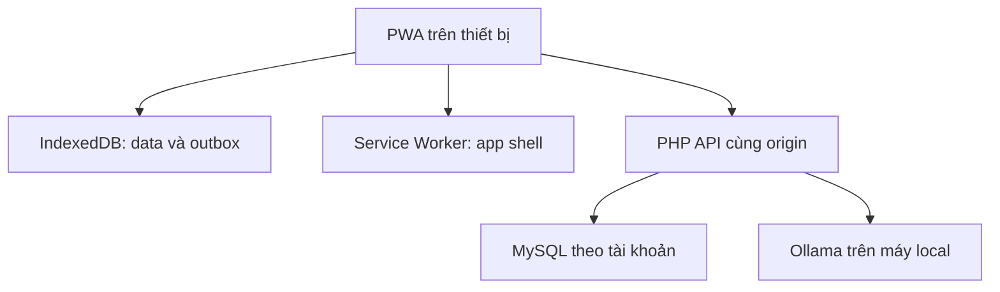

# 02 — Kiến trúc và contract dùng chung

## Kiến trúc tối giản


Đọc UI từ IndexedDB; gọi server để đồng bộ. Service Worker chỉ cache static asset, không giả response API khi mất mạng. Backend giữ logic auth/quyền/sync. Không thêm nhiều tầng service/repository chỉ để đủ tên kiến trúc; tách helper khi thật sự có logic dùng lại.

## Cấu trúc và trạng thái starter
- `public/`: duy nhất thư mục được serve; `js/modules/` là các màn hình đang placeholder.
- `server/`: helper/config/AI prompt, không được serve trực tiếp.
- `database/`: schema; không chứa database thật.
- `docs/`: scope/contract/task/handoff/test.
- `db.js` mới tạo stores; saveAndQueue/listRecords còn throw NOT_IMPLEMENTED.
- `sync.js` còn throw NOT_IMPLEMENTED. Auth/sync/snapshot/chat PHP trả 501.
- `domain/finance.js` có công thức cơ bản; chưa nối vào dữ liệu/UI sản phẩm.

## Data conventions
- Client IDs: UUID string, không đổi khi sync. User IDs là số nguyên do server cấp, lưu JS như chuỗi.
- `amount_vnd`: số nguyên dương an toàn cho JavaScript, tối đa 9.007.199.254.740.991; API cần giới hạn ứng dụng phù hợp hơn nếu nhóm muốn.
- `occurred_on`: YYYY-MM-DD theo ngày địa phương. Tránh dùng toISOString cắt ngày cho ngày giao dịch Việt Nam vì đó là UTC.
- `version`: số nguyên, server tăng sau thay đổi thành công; pending create dùng base_version=0.
- `deleted_at`: null hoặc timestamp ISO từ server; local pending delete dùng marker để ẩn UI nhưng vẫn giữ ID.
- `sync_status`: local only, pending/synced/error/conflict. Không cộng status như một khoản tiền mới.
- Timestamps metadata server là UTC; kỳ ngân sách dựa trên occurred_on, không theo ngày sync.

### Entities chính
| Entity | Trường bắt buộc ngoài metadata |
| --- | --- |
| wallet | id, user_id, name, opening_balance_vnd |
| transaction | id, user_id, wallet_id, type, amount_vnd, category_code, occurred_on, note; transfer có destination_wallet_id |
| budget | id, user_id, month YYYY-MM, limit_vnd; một budget tổng mỗi tháng |
| wishlist | id, user_id, name, price_vnd, review_on, status, purchased_transaction_id nullable |

Metadata chung: version, deleted_at, updated_at. DB schema là khởi đầu; API vẫn phải kiểm tra quyền sở hữu ví, enums và dữ liệu.

### Enums
- type: income, expense, transfer.
- category income: allowance, salary, scholarship, other_income.
- category expense: food, transport, study, shopping, entertainment, health, other_expense.
- transfer: category_code=null; destination_wallet_id bắt buộc khác wallet_id, cùng user.
- wishlist status: considering, bought, skipped.

Enum frontend nằm ở config.js; A phải mirror allowlist phía backend. Thay enum cập nhật cả hai và tài liệu. Không tự dịch code enum; chỉ dịch label UI.

### Công thức
- Số dư tổng = tổng số dư ban đầu các ví + toàn bộ thu - toàn bộ chi; transfer không đổi tổng.
- Ví riêng: opening + income vào ví - expense từ ví - transfer đi + transfer đến.
- Tổng theo tháng lọc occurred_on; bỏ tombstone; transfer không vào thu/chi.
- Ngân sách còn = limit tháng - expense tháng; giữ giá trị âm để hiện vượt mức.
- Mô phỏng một khoản chi: số dư và ngân sách cùng giảm price; không cộng hai nguồn thành tiền khả dụng.
- Linh hoạt trước = min(balance - reserved, budget_remaining). Sau = min(balance - reserved - price, budget_remaining - price). reserved là giả định giữ lại nằm sẵn trong số dư, không phải giao dịch mới.
- Chia đều/ngày = floor(linh hoạt / days_remaining), ngày bao gồm hôm nay. Đây là mô phỏng theo giả định, không cam kết thực tế.
- Trong MVP reserved nhập ở form, không có ledger mục tiêu tiết kiệm. Không tự suy ra từ một con số saved độc lập.

## IndexedDB contract (B triển khai, A/C gọi chung)
Stores tạo sẵn: wallets, transactions, budgets, wishlist, outbox, meta. Key id; entity store có index user_id. outbox có index user_id. Chỉ định đúng user hiện tại trong mọi query.

```js
await listRecords('transactions', userId); // live records của đúng user
await saveAndQueue({
  user_id: userId,
  entity: 'transaction',
  action: 'upsert', // hoặc delete
  record: transaction,
  base_version: 0
});
await syncNow(userId);
```

saveAndQueue tự tạo operation_id bằng UUID; lưu mutation và outbox cùng IDB transaction. Giữ operation_id khi retry. Các màn hình A/C không tự ghi localStorage hoặc mở thêm DB riêng.

```json
{
  "operation_id": "UUID",
  "user_id": "123",
  "entity": "transaction",
  "action": "upsert",
  "entity_id": "UUID",
  "base_version": 0,
  "record": {
    "id": "UUID",
    "wallet_id": "UUID",
    "type": "expense",
    "amount_vnd": 45000,
    "category_code": "food",
    "occurred_on": "2026-10-29",
    "note": "Ăn trưa"
  }
}
```

Trong wire request user_id không dùng làm nguồn phân quyền: server lấy user hiện tại từ session và từ chối quyền không hợp lệ. Frontend user_id để phân vùng local.

## API contract mục tiêu
Các endpoint dưới đây là kế hoạch; starter trả 501 trừ health.

| Method + URL | Input/Output | Người |
| --- | --- | --- |
| GET api/health.php | 200 scaffold, không chứng minh DB/AI sẵn sàng | A |
| POST api/auth.php?action=register | name,email,password → user | A |
| POST api/auth.php?action=login | email,password → user, csrf_token | A |
| GET api/auth.php?action=me | user, csrf_token hoặc 401 | A |
| POST api/auth.php?action=logout | clear session | A |
| POST api/sync.php | operations tối đa batch nhỏ, chẳng hạn 20 → results từng operation | A+B |
| GET api/snapshot.php | wallets,transactions,budgets,wishlist gồm tombstones của user | A+B |
| POST api/chat.php | message, context thống kê → reply/intent/draft có schema | C |

JSON response dùng một envelope:
```json
{"ok":true,"data":{}}
```
Lỗi:
```json
{"ok":false,"error":{"code":"NOT_IMPLEMENTED","message":"..."}}
```

Sync batch thành công nhận HTTP 200, nhưng mỗi result phải có ok/error; không coi cả batch đã xong chỉ vì HTTP 200. Ví dụ một result:
```json
{"operation_id":"UUID","ok":true,"record":{"id":"UUID","version":1}}
```
Conflict từng item: ok=false,error.code=CONFLICT, kèm server_record để UI giải quyết. Batch malformed có thể trả 422; chưa auth 401; request trực tiếp bị từ chối quyền 403. Server nhớ cả success/error receipt phù hợp để replay operation_id trả cùng kết quả. Sửa nội dung một thao tác đã rejected phải có operation_id mới.

## Sync MVP dễ ghép: push rồi pull full snapshot
1. B lưu local + outbox. Chỉ một sync coordinator đang chạy; serialize nhiều tab hoặc giới hạn một tab demo và ghi rõ.
2. Gửi thao tác theo thứ tự, không gửi song song tùy ý: tạo ví trước giao dịch, tạo giao dịch trước đánh dấu wishlist bought.
3. A dùng database transaction cho mutation + receipt; unique user/operation để chống replay kể cả request đồng thời.
4. Sau ACK, B chỉ xóa operation đã ACK; nếu user vừa sửa tiếp thì giữ thay đổi mới.
5. Lấy full snapshot theo user. Không thay sạch store khi còn pending: merge server theo ID rồi áp lại các local operation chưa ACK.
6. Dùng version kiểm tra optimistic concurrency. Conflict hiển thị, không tự chọn theo đồng hồ client. Bản đầu có thể giới hạn sửa hai thiết bị tuần tự, ghi giới hạn trung thực.
7. Không xóa hẳn tombstone trước khi thiết bị khác có thể nhận. 401 giữ queue; validation hiện lỗi; timeout giữ retry.
8. Khi đổi user: không lộ data cũ, không tự bỏ pending. Snapshot 401 khác với “server có 0 giao dịch”.

Full snapshot đủ để nhóm kiểm thử dataset cá nhân nhỏ, không phải thiết kế cho dữ liệu không giới hạn. Nếu sau này lớn: phân trang/incremental cursor; hiện chưa thêm queue/Redis hoặc bảng change-log.

## Chatbot local
PWA → API có session + CSRF → model Ollama local. Chỉ API backend biết URL model; client không tùy ý truyền URL để server fetch.

Intent whitelist:
- expense_summary: period/category; code tính số liệu, model diễn giải.
- simulate_purchase: item_name/price_vnd; mở công cụ mô phỏng, không save.
- draft_transaction: fields giao dịch; thiếu gì hỏi bổ sung; người dùng xác nhận bằng luồng thu chi chung.

Mẫu trả draft (chỉ ví dụ, không model response giả):
```json
{"ok":true,"data":{"intent":"draft_transaction","draft":{"type":"expense","amount_vnd":45000,"category_code":"food"},"missing_fields":["wallet_id","occurred_on"]}}
```

Schema model tại server/ai/response-schema.json là target object data. Validate enum/amount/date/owner trong code; JSON parse thành công chưa đủ. Không thực thi SQL/code do model sinh. Không cho AI tự xác nhận đã mua.

Context thống kê gửi theo user hiện tại, tối thiểu cần thiết, có as_of và pending_count. Với data local chưa sync, hiển thị đó là local snapshot; không giả dữ liệu đã được server xác thực. Không gửi API key, cấu hình hoặc toàn DB vào prompt.

Ollama dùng model đã tải; chưa chọn model cụ thể. Phiên bản PHP demo cùng máy có thể gọi http://127.0.0.1:11434/api/chat. Nếu backend chạy máy khác thì loopback đó là backend, không phải laptop của C. Điện thoại offline hoàn toàn không gọi được laptop. Cần test timeout/model unavailable và giới hạn request.

## Auth và deployment tối thiểu
PHP session cookie cùng origin, hash mật khẩu, regenerate session sau login, CSRF token cho request thay đổi và chat; PDO prepared statements; kiểm tra user sở hữu ví/record mọi lần. Không dùng user_id từ JSON để phân quyền. Offline là truy cập data local đã có, không phải xác thực server mới.

Chỉ public/ được serve. MySQL/config/prompt nội bộ ở ngoài docroot. Khi triển khai HTTPS cấu hình session cookie secure phù hợp. Không mở port Ollama trực tiếp ra Internet. Frontend public và Ollama laptop cần đường backend riêng, không mặc định chúng thấy nhau.

## Scalability vừa đủ
- Bắt đầu một PHP app + một MySQL + một Ollama; single repo.
- Index theo user_id/occurred_on hoặc month; query luôn theo user.
- Pagination danh sách UI; full snapshot chỉ dùng cho quy mô cá nhân nhỏ đã kiểm chứng.
- Không gửi toàn bộ lịch sử vào LLM; tóm tắt thống kê và giới hạn độ dài/context.
- AI timeout không khóa thao tác ghi sổ; thêm giới hạn request và thông báo bận khi cần.
- Sau khi có số đo thực mới quyết định cursor sync, cache server hoặc tách inference.
